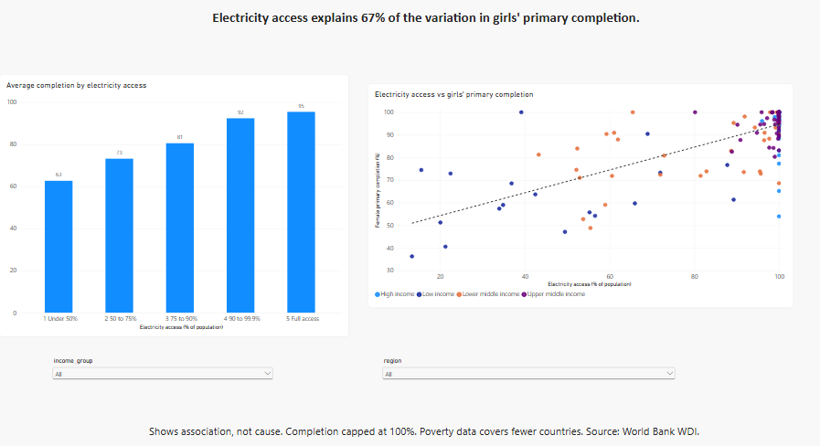

# Does electricity access predict whether girls finish primary school?

I wanted to know which of three things lines up best with girls finishing primary school across countries: electricity access, internet use, or extreme poverty. Electricity wins. It accounts for 67% of the variation in female primary completion, ahead of internet use at 61% and poverty at 54%.

## The data

I pulled four indicators from the World Bank's World Development Indicators, plus its country metadata file for regions and income groups.

- Primary completion rate, female (SE.PRM.CMPT.FE.ZS)
- Individuals using the internet (IT.NET.USER.ZS)
- Access to electricity (EG.ELC.ACCS.ZS)
- Poverty headcount at $3.00 a day (SI.POV.DDAY)

Each country shows its most recent value between 2019 and 2024.

## How I built it

I started in SQL. I loaded the five files into SQLite with DB Browser and wrote one query that takes each country's latest value, joins the four indicators on country code, and drops regional rows like "World" and "Sub-Saharan Africa". That left 172 countries.

Excel came next. 106 of those countries have all four indicators, so I copied them to their own sheet and ran RSQ for each indicator against completion. A scatter chart with a trendline confirmed the pattern by eye.

Power BI is the final layer. The dashboard has a scatter chart of electricity against completion, average completion by electricity band, and slicers for income group and region.

## What I found

Electricity access explains 67% of the variation in female primary completion. Internet use explains 61% and poverty explains 54%. All three together reach 70%, so electricity does most of the work.

Completion climbs with every step up in electricity access. Countries with under 50% access average 63% completion. Countries with full access average about 95%.

The pattern lives in poorer countries. Among lower middle income countries, electricity and completion correlate at 0.60. Among low income countries the figure is 0.40. In high income countries it drops to about zero, because nearly every girl finishes primary school there.

A few countries break the pattern. Sierra Leone reports 100% completion with 39% electricity access. Syria reports 61% completion with 89% access. Those two are the first I would investigate next.

## What this does not show

This is association, not cause. Poverty, electricity, and internet use overlap heavily (poverty and electricity correlate at -0.93), so the data cannot separate their effects.

I capped completion rates above 100% at 100%. Over-age students push some countries past 100, and 21 of the 106 countries in the analysis hit that.

Poverty data covers 126 of 217 countries, so the poverty comparison rests on a smaller sample than the other two.

Reference years differ by country, because I used each country's latest value from 2019 to 2024.

## Files

- `merge_query.sql`: the SQL query that builds the clean table
- `portfolio.db`: the SQLite database with the source tables
- `clean_data.csv`: the merged country-level dataset
- `clean_data_analysis.xlsx`: the RSQ checks and scatter chart
- `portfolio_dashboard.pbix`: the Power BI dashboard
- `screenshots/`: the SQL, Excel, and Power BI results

Tools: SQLite (DB Browser), Excel, Power BI Desktop.

Built by Darakhshan. Find me on LinkedIn: linkedin.com/in/darakhshan-shaikh-34a119283
